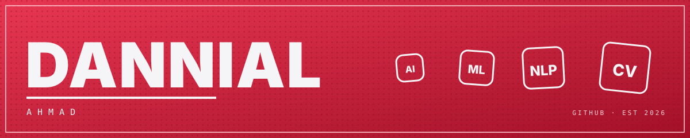
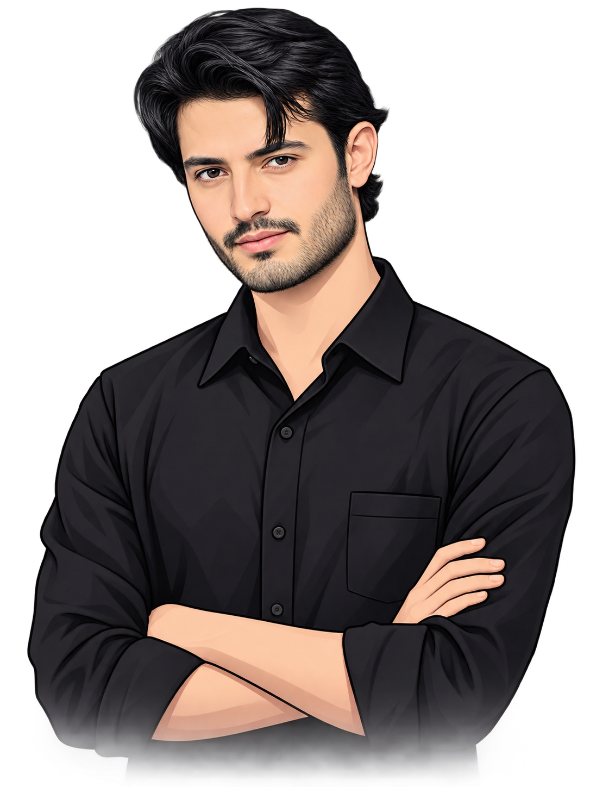

## `01 /` Identity

<strong>I'm Danyal Ahmad</strong>, an AI/ML enthusiast and Computer Science professional passionate about transforming complex ideas into practical, intelligent, and autonomous technologies. My interests span <strong>Artificial Intelligence, Machine Learning, Deep Learning, Computer Vision, Natural Language Processing (NLP), Generative AI, and Intelligent Systems</strong>. I enjoy exploring emerging technologies, experimenting with AI-powered tools, and developing real-world applications that solve meaningful problems through machine intelligence.My primary focus is on the intersection of <strong>AI, Machine Learning, Computer Vision, Agentic AI, and Intelligent Automation</strong>. I'm particularly interested in developing AI agents, multi-agent systems, autonomous workflows, intelligent decision-making systems, and AI-powered applications that can understand information, process complex tasks, interact with different technologies, and execute actions with minimal human intervention.
I enjoy working across the complete AI development lifecycle, from research, data processing, model exploration, and system architecture to implementation, integration, testing, deployment, and continuous improvement. My goal is to build intelligent, scalable, and practical AI solutions that go beyond basic automation and bring together perception, reasoning, learning, and autonomous execution.

 

<!-- ════════════════════════════════════════════════════════════════════ -->
<!--  02 / STACK MATRIX                                                   -->
<!-- ════════════════════════════════════════════════════════════════════ -->

## `02 /` Stack Matrix

  
   
  
   
  

<!-- ════════════════════════════════════════════════════════════════════ -->
<!--  03 / GITHUB STATS                                                   -->
<!-- ════════════════════════════════════════════════════════════════════ -->

## `03 /` GitHub Stats

<!-- ════════════════════════════════════════════════════════════════════ -->
<!--  04 / CONTRIBUTION ATLAS                                             -->
<!-- ════════════════════════════════════════════════════════════════════ -->

## `04 /` Contribution Atlas

The year drawn two ways. The orbit maps 53 weeks around a ring, one lap of the calendar, latest active day pulsing at the rim, in the brand's red scale. The 3D calendar raises every contribution into a slab. Both follow your theme.

<picture>
  <source media="(prefers-color-scheme: dark)" srcset="https://raw.githubusercontent.com/dannial-ahmad/dannial-ahmad/output/github-snake-dark.svg">
  <source media="(prefers-color-scheme: light)" srcset="https://raw.githubusercontent.com/dannial-ahmad/dannial-ahmad/output/github-snake.svg">
  
</picture>
  
 
<picture>
  <source media="(prefers-color-scheme: dark)" srcset="https://raw.githubusercontent.com/dannial-ahmad/dannial-ahmad/output-3d-contrib/profile-night-rainbow.svg">
  <source media="(prefers-color-scheme: light)" srcset="https://raw.githubusercontent.com/dannial-ahmad/dannial-ahmad/output-3d-contrib/profile-night-rainbow.svg">
  
</picture>

 

## `05 /` What I'm Learning

Every week has a focus: depth on one tool pushed past the tutorial, breadth across what is new in applied ML. Depth without breadth becomes dogma, breadth without depth becomes a logo collection.

**This week - deep work**

- `TensorFlow` - training pipelines and honest evaluation
- `Ollama` - running and steering local LLMs
- `Streamlit` - turning notebooks into usable apps

 

**On the radar - exploring**

- `ML System Design` - pipelines that survive contact with production
- `Data Analysis` - asking better questions of the data
- `Gradio` - the fastest path from model to demo
- `Docker` - reproducible environments, no excuses

## `06 /` Philosophy

- **Models that ship > models that score.** Production impact is the only metric that survives contact with reality.
- **Clean pipelines, clear thinking.** The state of the pipeline mirrors the state of the mind that built it. Both deserve maintenance.
- **Break, test, iterate.** Small verified steps beat big untested leaps. Confidence comes from evidence, not vibes.
- **Docs people actually read.** If the explanation is unusable, the work is unfinished. Writing is engineering.
- **Show the real numbers.** Small honest telemetry beats big decorated vanity metrics.

## `07 /` Connect

&nbsp;

