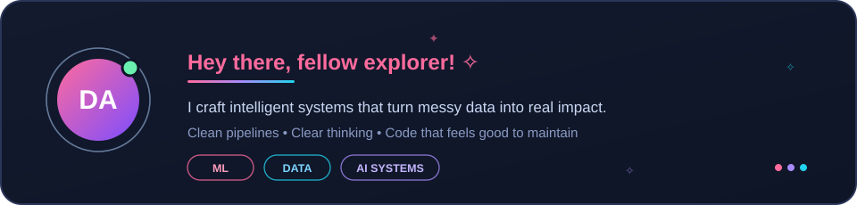
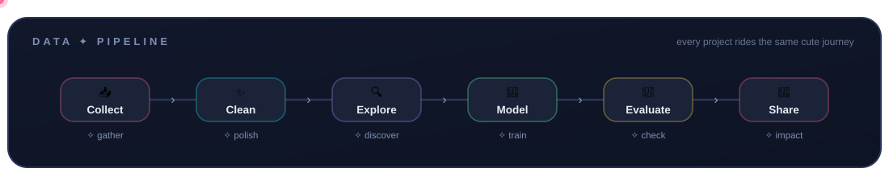
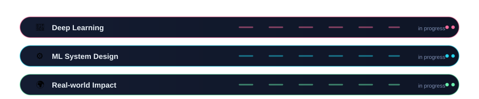
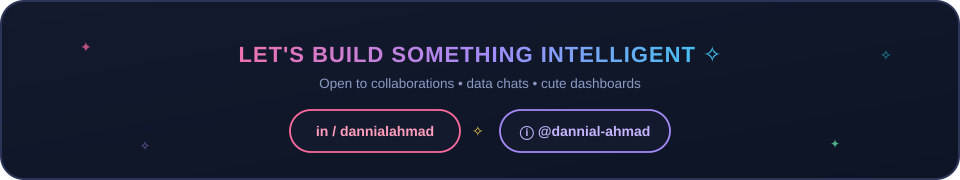

<!-- ═══════════════ HERO ═══════════════ -->

 

 

---

### 1. 🌸 About Me

I'm **Dannial Ahmad** — I build intelligent systems that turn messy data into clear, useful outcomes.
I care about clean pipelines, measurable impact, and code that other people actually enjoy working with.

 

 

### 2. ✨ Tech Arsenal

**Core stack I live in every day**

`Python` · `SQL` · `Scikit-learn` · `Pandas` · `NumPy` · `Matplotlib` · `TensorFlow` · `Power BI` · `Streamlit` · `Gradio` · `Ollama`

 

 

### 3. 🪄 Data Pipeline

Collect → Clean → Explore → Model → Evaluate → Share
Every build follows this cute little journey.

 

 

### 4. 💎 Working Style

 

 

### 5. 🎯 Current Focus

 

 

### 6. ♡ Interests

 

 

### 7. 📊 GitHub Metrics

  

  

 

 

### 8. 🏆 Achievements

 

 

### 9. 🐍 Contribution Snake

<picture>
  <source media="(prefers-color-scheme: dark)" srcset="https://raw.githubusercontent.com/dannial-ahmad/dannial-ahmad/output/github-snake-dark.svg"/>
  <source media="(prefers-color-scheme: light)" srcset="https://raw.githubusercontent.com/dannial-ahmad/dannial-ahmad/output/github-snake.svg"/>
  
</picture>

*(The snake is generated automatically by a GitHub Action — it appears once the `Generate Snake` workflow runs.)*

 

 

### 10. 🌈 Connect With Me

 

 

**Thanks for visiting!**
Feel free to star ⭐ the profile or connect on LinkedIn if you want to build something cool together.

