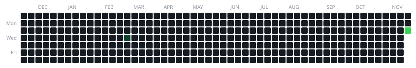

 

&nbsp;

&nbsp;

<!-- ════════════════════════════════════════════════════════════════════ -->
<!--  01 / IDENTITY                                                       -->
<!-- ════════════════════════════════════════════════════════════════════ -->

## `01 /` Identity

I'm **Dannial Ahmad**, an AI/ML engineer turning messy data into systems people actually use. The work spans deep learning, data analysis, and applied AI: models that earn their keep, pipelines that stay clean, and interfaces a real user can touch.

Every graphic on this page is generated from this account's live GitHub data: the banner, the stack matrix, the orbit, the snake, and the repo cards are rebuilt on every update and hosted in this repository's own branches. The numbers are the numbers.

<picture><source media="(prefers-color-scheme: dark)" srcset="https://raw.githubusercontent.com/dannial-ahmad/dannial-ahmad/output/section-divider-dark.svg"><source media="(prefers-color-scheme: light)" srcset="https://raw.githubusercontent.com/dannial-ahmad/dannial-ahmad/output/section-divider.svg"></picture>

<!-- ════════════════════════════════════════════════════════════════════ -->
<!--  02 / STACK MATRIX                                                   -->
<!-- ════════════════════════════════════════════════════════════════════ -->

## `02 /` Stack Matrix

<picture><source media="(prefers-color-scheme: dark)" srcset="https://raw.githubusercontent.com/dannial-ahmad/dannial-ahmad/output/section-divider-dark.svg"><source media="(prefers-color-scheme: light)" srcset="https://raw.githubusercontent.com/dannial-ahmad/dannial-ahmad/output/section-divider.svg"></picture>

<!-- ════════════════════════════════════════════════════════════════════ -->
<!--  03 / GITHUB STATS                                                   -->
<!-- ════════════════════════════════════════════════════════════════════ -->

## `03 /` GitHub Stats

<picture><source media="(prefers-color-scheme: dark)" srcset="https://raw.githubusercontent.com/dannial-ahmad/dannial-ahmad/output/section-divider-dark.svg"><source media="(prefers-color-scheme: light)" srcset="https://raw.githubusercontent.com/dannial-ahmad/dannial-ahmad/output/section-divider.svg"></picture>

<!-- ════════════════════════════════════════════════════════════════════ -->
<!--  04 / CONTRIBUTION ATLAS                                             -->
<!-- ════════════════════════════════════════════════════════════════════ -->

## `04 /` Contribution Atlas

The year drawn two ways. The orbit maps 53 weeks around a ring, one lap of the calendar, with the latest active day pulsing at the rim. The 3D calendar raises every contribution into a slab. Both follow your theme.

<picture>
  <source media="(prefers-color-scheme: dark)" srcset="https://raw.githubusercontent.com/dannial-ahmad/dannial-ahmad/output/contribution-orbit-dark.svg">
  <source media="(prefers-color-scheme: light)" srcset="https://raw.githubusercontent.com/dannial-ahmad/dannial-ahmad/output/contribution-orbit.svg">
  
</picture>

  

<picture>
  <source media="(prefers-color-scheme: dark)" srcset="https://raw.githubusercontent.com/dannial-ahmad/dannial-ahmad/output-3d-contrib/profile-night-rainbow.svg">
  <source media="(prefers-color-scheme: light)" srcset="https://raw.githubusercontent.com/dannial-ahmad/dannial-ahmad/output-3d-contrib/profile-green-animate.svg">
  
</picture>

<picture><source media="(prefers-color-scheme: dark)" srcset="https://raw.githubusercontent.com/dannial-ahmad/dannial-ahmad/output/section-divider-dark.svg"><source media="(prefers-color-scheme: light)" srcset="https://raw.githubusercontent.com/dannial-ahmad/dannial-ahmad/output/section-divider.svg"></picture>

<!-- ════════════════════════════════════════════════════════════════════ -->
<!--  05 / GITHUB SNAKE                                                   -->
<!-- ════════════════════════════════════════════════════════════════════ -->

## `05 /` GitHub Snake

The classic contribution snake, drawn from the account's real calendar: the snake travels the whole year week by week, and the lit cells are the days that count. Watch it make one full lap.

<picture>
  <source media="(prefers-color-scheme: dark)" srcset="https://raw.githubusercontent.com/dannial-ahmad/dannial-ahmad/output/github-snake-dark.svg">
  <source media="(prefers-color-scheme: light)" srcset="https://raw.githubusercontent.com/dannial-ahmad/dannial-ahmad/output/github-snake.svg">
  
</picture>

<picture><source media="(prefers-color-scheme: dark)" srcset="https://raw.githubusercontent.com/dannial-ahmad/dannial-ahmad/output/section-divider-dark.svg"><source media="(prefers-color-scheme: light)" srcset="https://raw.githubusercontent.com/dannial-ahmad/dannial-ahmad/output/section-divider.svg"></picture>

<!-- ════════════════════════════════════════════════════════════════════ -->
<!--  06 / TRENDING REPOS                                                 -->
<!-- ════════════════════════════════════════════════════════════════════ -->

## `06 /` Trending Repos

Two builds, shipped in public from day one. Cards refresh with every push: stars, code volume, and the timeline from creation to the latest change.

 

**Ai-market-analyst** - an AI workspace for reading markets, built Jupyter-native and shipped in public from day one.

**ML-Powered-Loan-Approval-Predictor** - a machine learning take on loan approval decisions, from data cleaning to an honest evaluation of the final model.

Both are early. The point of shipping in public is to let real feedback, not private perfection, shape the next change.

<picture><source media="(prefers-color-scheme: dark)" srcset="https://raw.githubusercontent.com/dannial-ahmad/dannial-ahmad/output/section-divider-dark.svg"><source media="(prefers-color-scheme: light)" srcset="https://raw.githubusercontent.com/dannial-ahmad/dannial-ahmad/output/section-divider.svg"></picture>

## `07 /` What I'm Learning

Every week has a focus: depth on one tool pushed past the tutorial, breadth across what is new in applied ML. Depth without breadth becomes dogma, breadth without depth becomes a logo collection.

**This week - deep work**

- `TensorFlow` - training pipelines and honest evaluation
- `Ollama` - running and steering local LLMs
- `Streamlit` - turning notebooks into usable apps

 

**On the radar - exploring**

- `ML System Design` - pipelines that survive contact with production
- `Data Analysis` - asking better questions of the data
- `Gradio` - the fastest path from model to demo
- `Docker` - reproducible environments, no excuses

<picture><source media="(prefers-color-scheme: dark)" srcset="https://raw.githubusercontent.com/dannial-ahmad/dannial-ahmad/output/section-divider-dark.svg"><source media="(prefers-color-scheme: light)" srcset="https://raw.githubusercontent.com/dannial-ahmad/dannial-ahmad/output/section-divider.svg"></picture>

## `08 /` Philosophy

- **Models that ship > models that score.** Production impact is the only metric that survives contact with reality.
- **Clean pipelines, clear thinking.** The state of the pipeline mirrors the state of the mind that built it. Both deserve maintenance.
- **Break, test, iterate.** Small verified steps beat big untested leaps. Confidence comes from evidence, not vibes.
- **Docs people actually read.** If the explanation is unusable, the work is unfinished. Writing is engineering.
- **Show the real numbers.** Small honest telemetry beats big decorated vanity metrics.

<picture><source media="(prefers-color-scheme: dark)" srcset="https://raw.githubusercontent.com/dannial-ahmad/dannial-ahmad/output/section-divider-dark.svg"><source media="(prefers-color-scheme: light)" srcset="https://raw.githubusercontent.com/dannial-ahmad/dannial-ahmad/output/section-divider.svg"></picture>

## `09 /` Connect

&nbsp;

