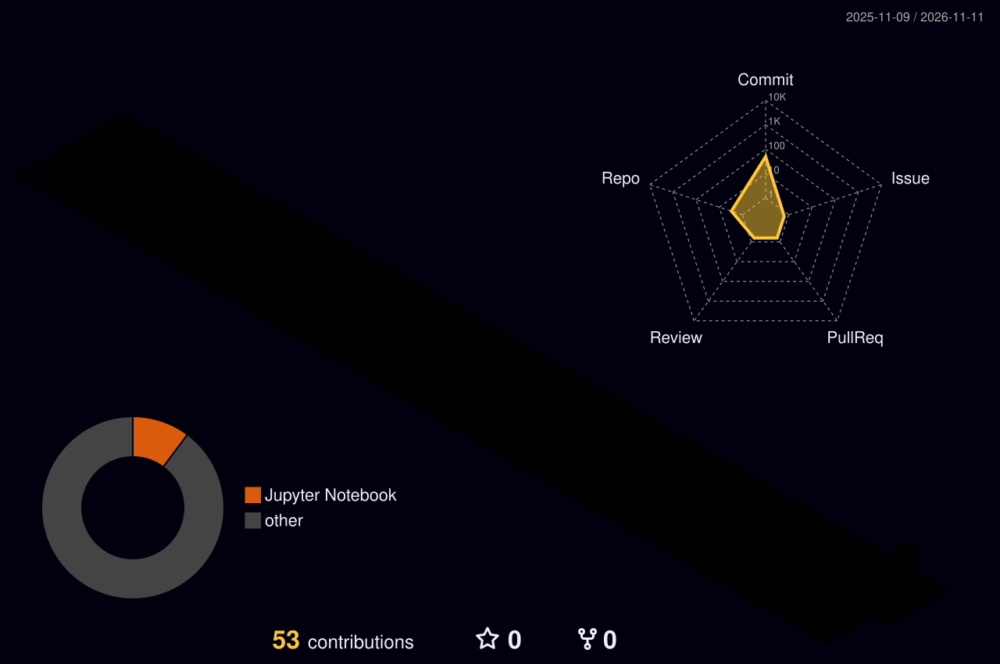

 

&nbsp;

&nbsp;

&nbsp;

 

 

<!-- ════════════════════════════════════════════════════════════════════ -->
<!--  01 / IDENTITY                                                       -->
<!-- ════════════════════════════════════════════════════════════════════ -->

## `01 /` Identity

I'm **Dannial Ahmad**, an AI/ML engineer turning messy data into systems people actually use. The work spans deep learning, data analysis, and applied AI: models that earn their keep, pipelines that stay clean, and interfaces a real user can touch.

Every graphic on this page is built from this account's real GitHub data: contribution snake, 3D contribution calendar, streak telemetry, language stats. The numbers are the numbers.

 

## `02 /` Stack

**Languages**
 

 

**AI & ML**
 

 

**Tools**
 

 

**Data & App Layer**
 

&nbsp;

&nbsp;

&nbsp;

&nbsp;

&nbsp;

&nbsp;

&nbsp;

 

 

<!-- ════════════════════════════════════════════════════════════════════ -->
<!--  03 / GITHUB STATS                                                   -->
<!-- ════════════════════════════════════════════════════════════════════ -->

## `03 /` GitHub Stats

 

 

 

## `04 /` Contribution Atlas

The daily log, drawn two ways. The dark and light variants follow your theme.

<picture>
  <source media="(prefers-color-scheme: dark)" srcset="https://raw.githubusercontent.com/dannial-ahmad/dannial-ahmad/output/github-snake-dark.svg">
  <source media="(prefers-color-scheme: light)" srcset="https://raw.githubusercontent.com/dannial-ahmad/dannial-ahmad/output/github-snake.svg">
  
</picture>

  

<picture>
  <source media="(prefers-color-scheme: dark)" srcset="https://raw.githubusercontent.com/dannial-ahmad/dannial-ahmad/output-3d-contrib/profile-night-rainbow.svg">
  <source media="(prefers-color-scheme: light)" srcset="https://raw.githubusercontent.com/dannial-ahmad/dannial-ahmad/output-3d-contrib/profile-green-animate.svg">
  
</picture>

 

 

## `05 /` Currently Building

Two builds are live, both notebook-first:

**Ai-market-analyst** - an AI workspace for reading markets, built Jupyter-native and shipped in public from day one.

**ML-Powered-Loan-Approval-Predictor** - a machine learning take on loan approval decisions, from data cleaning to an honest evaluation of the final model.

Both are early. The point of shipping in public is to let real feedback, not private perfection, shape the next commit.

 

 

## `06 /` What I'm Learning

Every week has a focus: depth on one tool pushed past the tutorial, breadth across what is new in applied ML. Depth without breadth becomes dogma, breadth without depth becomes a logo collection.

**This week - deep work**

- `TensorFlow` - training pipelines and honest evaluation
- `Ollama` - running and steering local LLMs
- `Streamlit` - turning notebooks into usable apps

 

**On the radar - exploring**

- `ML System Design` - pipelines that survive contact with production
- `Data Analysis` - asking better questions of the data
- `Gradio` - the fastest path from model to demo
- `Docker` - reproducible environments, no excuses

 

 

## `07 /` Philosophy

- **Models that ship > models that score.** Production impact is the only metric that survives contact with reality.
- **Clean pipelines, clear thinking.** The state of the pipeline mirrors the state of the mind that built it. Both deserve maintenance.
- **Break, test, iterate.** Small verified steps beat big untested leaps. Confidence comes from evidence, not vibes.
- **Docs people actually read.** If the explanation is unusable, the work is unfinished. Writing is engineering.
- **Show the real numbers.** Small honest telemetry beats big decorated vanity metrics.

 

 

## `08 /` Quote

 

 

## `09 /` Connect

&nbsp;

