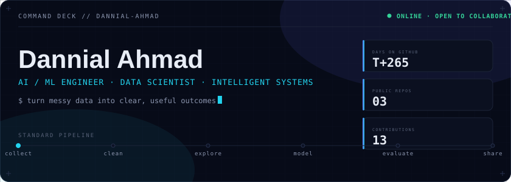
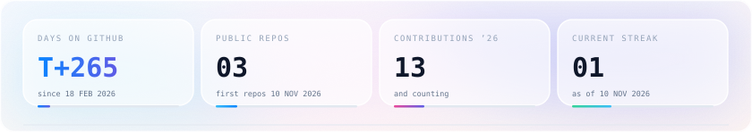

 

 

<em>"Turning messy data into clear, useful outcomes."</em>

  

&nbsp;

&nbsp;

<!-- ════════════════════════════════════════════════ 01 ══ -->
 

I'm **Dannial Ahmad** — an AI/ML engineer building intelligent systems that turn messy data into clear, useful outcomes. The work spans machine learning, data analysis, and applied AI: models that are actually useful, pipelines that stay clean, and interfaces people genuinely want to use.

Every graphic on this page — the dashboard, the section headers, the stat widgets, the timeline — is a hand-built SVG generated from real repository data, hosted in this repo and rendered locally. Nothing depends on a third-party service staying up, so nothing here can break.

 

<!-- ════════════════════════════════════════════════ 02 ══ -->

The toolchain is organized the way the work actually flows: languages at the core, the ML stack for modeling, app frameworks for shipping, and infrastructure for keeping it all reproducible.

 

<!-- ════════════════════════════════════════════════ 03 ══ -->

Three tracks, one direction — systems that work outside the notebook.

**Deep Learning** — pushing past tutorials: shaping datasets properly, training honestly, evaluating against baselines that matter. The goal is judgment — knowing why a model fails, not just that it failed.

**ML System Design** — learning to think in systems rather than notebooks. How data pipelines, models, and serving layers fit together so the whole thing survives contact with real usage instead of demo conditions.

**Real-world Impact** — the north star. Interfaces a real user can actually touch: interactive apps with `Streamlit` and `Gradio`, local LLM experiments with `Ollama`, reporting that decisions get made from. A model nobody can use is a hobby; a system people use is impact.

 

<!-- ════════════════════════════════════════════════ 04 ══ -->

Every week splits into **depth** — one tool pushed past the tutorial — and **breadth** — surveying what's new in applied ML. Depth without breadth becomes dogma; breadth without depth becomes a logo collection.

**This week — deep work**

- `TensorFlow` — training pipelines & honest evaluation
- `Ollama` — running and steering local LLMs
- `Streamlit` — turning notebooks into usable apps

 

<b>On the radar — exploring</b>

 

- `ML System Design` — patterns for pipelines that survive production
- `Data Analysis` — craft: asking better questions of the data
- `Pipeline hygiene` — clean, testable, reproducible data flows
- `Interface design` — ML surfaces people enjoy using
- `Gradio` — faster paths from model to demo

 

<!-- ════════════════════════════════════════════════ 05 ══ -->

- **Impact over metrics.** A deployed system with a clear trade-off story beats a perfect score nobody can use.
- **Clean pipelines, clear thinking.** The state of the pipeline mirrors the state of the thinking. Both deserve maintenance.
- **Break • test • iterate.** Small steps, verified constantly. Confidence comes from evidence, not vibes.
- **Docs people actually read.** If the explanation is unusable, the work is unfinished. Writing is engineering.
- **Show the real numbers.** Small honest telemetry beats big decorated vanity metrics. Measure, don't decorate.

 

<!-- ════════════════════════════════════════════════ 06 ══ -->

How the method shows up day to day. Every build runs the same standard pipeline — collect, clean, explore, model, evaluate, share — because skipping a stage always costs more later than running it costs now. Experiments are verified constantly rather than trusted: small steps, quick tests, evidence over vibes. Everything gets written down as if a teammate has to pick it up tomorrow, because readable code and real documentation are part of the deliverable, not an afterthought. And nothing stays hidden in a branch until it is perfect — work is shared early and reviewed often, because feedback is the fastest debugger there is.

 

<!-- ════════════════════════════════════════════════ 07 ══ -->

Telemetry, not vanity. The widgets below are generated from this account's real GitHub data — days on platform, public repos, contributions, streak — rendered as local SVG cards instead of third-party widgets, so they always load and they never lie.

 

<!-- ════════════════════════════════════════════════ 08 ══ -->

The road so far, plotted on a real timeline: journey start in February, a long quiet build phase, and the first repositories going live in November. Early logs are short — that is what the beginning of a log looks like.

 

<!-- ════════════════════════════════════════════════ 09 ══ -->

Status: **open to collaborate.** Most useful around machine learning experiments, data analysis, and building intelligent systems end to end — from raw data to a working interface. If a project needs someone who treats pipelines, evaluation, and documentation as first-class deliverables, that is exactly the kind of work I take on.

 

<!-- ════════════════════════════════════════════════ 10 ══ -->

&nbsp;

  

